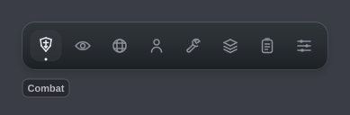

# Nocturne

A single-file Luau interface library for Roblox with a dark, glossy look: a floating glass **dock** at the top of the screen, a compact tabbed window, two-column sections, and a full set of themed controls.



Every icon is drawn from plain GuiObjects, the same way the color picker and soft shadows are, so the library needs **no uploaded image assets**.

```lua
local Library = require(game.ReplicatedStorage.Nocturne)
```

`Nocturne.lua` is an ordinary ModuleScript that returns the library table. [`Example.lua`](Example.lua) builds six tabs and uses every element.

## Features

- **Floating dock.** Each tab gets an icon in a glass dock at the top centre of the screen. Click an icon to open that tab. Click the active icon again to close the window; the dock stays. A highlight pill glides between icons and carries an accent dot, and hovering shows a small label.
- **Window.** A brand header with badge, profile and minimise/close buttons, category tabs with a sliding indicator, a scrolling two-column page area and a status footer. You can drag it by the header, and it opens and closes with a scale-and-fade.
- **Sections** with optional header tabs. One panel can hold several control groups (`Tabs = { "Crosshair", "Color" }`).
- **Elements:** toggle (check or switch style), slider with typeable value, dropdown (single or multi-select), text/number input, keybind, color picker (SV square, hue bar, hex, presets), button (same-row and confirm-to-click), label, paragraph, info row and divider.
- **Keybinds** refuse keys that are already in use (with a notification), cancel with Esc, clear with Backspace, attach to toggles (Toggle or Hold mode) and show in an optional keybind-list overlay.
- **Built-in Configs tab:** save, load, rename and delete named configs, and export/import as JSON. Configs persist per player when `server/ConfigPersistence.server.lua` is installed; otherwise they last for the session.
- **Built-in Settings tab:** 7 theme presets, a custom accent color, window transparency, glossy effects on/off, background blur, UI scale, menu key, tooltips, reduced motion, animation speed, notification options, a watermark (single or two row) and a keybind list.
- **Polish:** layered soft shadows, top-lit gradients, 1px glass edges, hover/press states on everything, quint easing, and no stacked animations when you click fast.
- **Responsive.** The window scales down to fit small screens, and mouse and touch both drive sliders, pickers and dragging.

## Repository layout

```
Nocturne.lua                 single-file build (what you require)
Example.lua                  example LocalScript using every element
README.md
src/Nocturne/                modular source (Rojo-compatible)
  init.luau                  public Library API
  App.luau                   window/dock/overlay wiring
  Core/ Animations/ Themes/ Icons/ Components/ Navigation/ Overlays/ Config/ Builtins/
server/ConfigPersistence.server.lua   optional DataStore persistence
tools/bundle.py              src/ -> Nocturne.lua
tools/export_assets.py       icons -> assets/icons/*.svg, preview sheets
tools/smoketest/             headless test that runs Example.lua and clicks everything
assets/icons/                SVG exports of every built-in icon
assets/references/           the reference screenshots the design was based on
docs/                        design guide, reference notes, installation
default.project.json         Rojo project (library + server script)
```

## Window

```lua
local Window = Library:CreateWindow({
	Title = "Nocturne",                     -- brand text in the header
	SubTitle = "Interface",                 -- dim text after the title
	Badge = "Plus",                         -- small pill next to the title
	Theme = "Midnight",                     -- Midnight, Graphite, Obsidian, Nord, Mocha, Tokyo Night, Rose Pine
	Accent = nil,                           -- Color3 to override the theme accent
	ToggleKey = Enum.KeyCode.RightControl,  -- menu key (rebindable in Settings)
	Footer = "nocturne.ui",                 -- footer centre text
	Build = "Build <b>1.0.0</b>",           -- footer right text (RichText)
	Scale = 1,                              -- user scale; small screens shrink automatically
	Blur = false,                           -- blur the world while the window is open
	OpenOnStart = true,
	ConfigsTab = true,                      -- add the built-in Configs tab
	SettingsTab = true,                     -- add the built-in Settings tab
})

Window:SelectTab("Combat")   -- by title, index or tab object
Window:Open()  Window:Close()  Window:Toggle()
Window:SetScale(0.9)
```

The built-in tabs are added after your script finishes its setup, so they always sit at the end of the dock.

## Tabs and sections

```lua
local Combat = Window:AddTab({ Title = "Combat", Icon = "combat" })

local Feedback = Combat:AddSection({ Title = "Feedback", Side = "Left" })

-- A section with header tabs:
local Cross = Combat:AddSection({ Tabs = { "Crosshair", "Color" }, Side = "Right" })
Cross:AddToggle("Crosshair", { Title = "Show crosshair" })   -- goes in the first tab
local ColorTab = Cross:Tab("Color")
ColorTab:AddColorPicker("CrossColor", { Title = "Crosshair color" })
```

- `Side` accepts `"Left"`, `"Right"`, `1` or `2`. If you leave it out, sections alternate between columns.
- `Section:SetVisible(bool)` hides a whole panel.

**Built-in icons:** `combat`, `visuals`, `world`, `player`, `settings`, `configs`, `utilities`, `misc`, `sparkle`, `palette`, `bell`, `info`, `warning`, `success`, `search`, `keyboard`, `save`, `load`, `copy`, `trash`, `pencil`, `plus`, `check`, `chevron`, `close`, `minimize`, `maximize`. To add your own, put another entry in `Icons.Glyphs` (see `src/Nocturne/Icons/Icons.luau`). Glyphs are lines, rings, rounded rects and dots on an 18×18 grid.

## Elements

Every element takes `(flag, options)` or `(options)` with `options.Flag`. If you leave the flag out, one is generated from the tab, section and title. Flagged elements are saved in configs; pass `Save = false` to keep one out.

### Toggle

```lua
local Toggle = Section:AddToggle("HitMarkers", {
	Title = "Hit markers",
	Default = true,
	Tooltip = "Shown on hover (a ? icon appears)",
	Callback = function(value) end,
})
Toggle:AddKeybind("HitMarkersKey", { Default = Enum.KeyCode.H, Mode = "Toggle" })  -- or "Hold"
Toggle:AddColorPicker("HitMarkerColor", { Default = Color3.new(1, 1, 1) })

Section:AddSwitch("Subtitles", { Title = "Subtitles" })  -- same API, pill switch style
```

### Button

```lua
Section:AddButton({ Title = "Info", Callback = function() end })
	:AddButton({ Title = "Reset", Style = "Danger", Confirm = true, Callback = function() end })  -- same row
```

`Style` is `"Default"`, `"Primary"` or `"Danger"`. `Icon` takes a built-in icon name. With `Confirm = true` (or a string to show), the callback runs only on a second click within 2.5 s.

### Slider

```lua
Section:AddSlider("FieldOfView", {
	Title = "Field of view", Min = 50, Max = 110, Default = 70,
	Increment = 1,        -- or Rounding = 2 (decimal places)
	Suffix = "°",
	Callback = function(value) end,
})
```

Click the value to type an exact number. Values snap to the increment and clamp to Min/Max.

### Dropdown

```lua
local Mode = Section:AddDropdown("CameraMode", {
	Title = "Camera mode",
	Values = { "Classic", "Follow", "Over shoulder" },
	Default = "Classic",       -- or an index (1)
	Multi = false,             -- true: Value is a set { Forest = true }
	AllowNull = false,
	Placeholder = "None",
	Callback = function(value) end,
})
Mode:SetValues({ "A", "B" })   -- alias :Refresh()
Mode:AddValue("C")
Mode:RemoveValue("A")
Mode:GetSelected()             -- array, in list order
```

### Input

```lua
Section:AddInput("Level", {
	Title = "Starting level", Default = 1, Placeholder = "1-100",
	Numeric = true, Min = 1, Max = 100,   -- Value is a number when Numeric
	Finished = true,                      -- fire on Enter / focus lost instead of every keystroke
	MaxLength = 10,
	Callback = function(value) end,
})
```

### Keybind

```lua
local Ultimate = Section:AddKeybind("Ultimate", {
	Title = "Ultimate",
	Default = Enum.KeyCode.F,        -- or "F", "MouseButton2", "None"
	Mode = "Toggle",                 -- "Toggle" | "Hold" | "Always"
	Callback = function(state) end,  -- state changes
	ChangedCallback = function(key) end,
})
Ultimate:OnClick(function() end)     -- every press
Ultimate:GetState()
Ultimate:SetValue("G", "Hold")
```

Click the pill and press a key to rebind. Esc cancels, Backspace clears, and a key that's already used elsewhere is refused with a notification. Keybinds ignore presses while a text box has focus.

### Color picker

```lua
local Accent = Section:AddColorPicker("HudAccent", {
	Title = "HUD accent",
	Default = Color3.fromRGB(205, 211, 224),
	Callback = function(color) end,
})
Accent:SetValue(Color3.new(1, 0, 0))
```

### Label, paragraph, info, divider

```lua
local Status = Section:AddLabel("Lock-on: <b>enabled</b>")   -- RichText
Status:SetText("Lock-on: <b>disabled</b>")
local Tips = Section:AddParagraph({ Title = "Tips", Content = "..." })
Tips:SetContent("...")
local Ping = Section:AddInfo({ Title = "Ping", Value = "42 ms" })   -- key/value row
Ping:Set("40 ms")
Section:AddDivider("optional label")
```

### Shared element API

| Member | Description |
| --- | --- |
| `.Value` | Current value |
| `:SetValue(value)` | Sets the value and fires callbacks when it changes |
| `:OnChanged(fn)` | Extra change listener (chainable) |
| `:SetVisible(bool)` | Shows or hides the element |
| `:Reset()` | Restores the default (toggles and sliders) |
| `:Destroy()` | Removes the element and its flag |

`Library.Flags[flag]` holds each flag's plain value, and `Library.Options[flag]` holds the element object.

## Configs

The **Configs** tab handles everything below. The same actions are available from code:

```lua
Library:SaveConfig("ranked")      -- returns ok, message
Library:LoadConfig("ranked")
Library:DeleteConfig("ranked")
Library:GetConfigs()              -- { "ranked", ... }
Library:ExportConfig()            -- JSON of the current settings
Library:ImportConfig(json)
```

Configs are kept in memory for the session by default. For per-player cloud saves, add `server/ConfigPersistence.server.lua` to ServerScriptService. It creates `ReplicatedStorage.NocturneConfigs` and stores configs with DataStoreService, validating names and sizes and limiting request rate. The Configs tab shows which storage is active.

## Customization

```lua
Library:SetTheme("Tokyo Night")
Library:SetAccent(Color3.fromRGB(235, 188, 186))   -- nil returns to the theme accent
Library:Notify({ Title = "Saved", Content = "Rich <b>text</b>", Type = "Success", Duration = 4 })
-- Type: "Info" | "Success" | "Warning" | "Error"; also Library:Notify("text", seconds)
Library:Toggle()
```

For anything else, `Library.App` exposes the lower-level app: `SetTransparency(0..0.6)`, `SetGloss(bool)`, `SetBlur(bool)`, `SetScale(n)`, `SetReducedMotion(bool)`, `SetAnimationSpeed(n)`, `SetNotifications({ Enabled, Duration, Position, Sound })`, `SetTooltips(bool)`, `Watermark:SetEnabled(bool)`, `Watermark:SetStyle("Single Row" | "Two Row")` and `KeybindList:SetEnabled(bool)`.

**Theme tokens:** `Backdrop`, `Surface`, `Surface2`, `Hover`, `Elevated`, `Border`, `BorderStrong`, `Text`, `TextDim`, `TextMuted`, `Accent`, `AccentText`, `Success`, `Warning`, `Danger`, `Shadow`. To add a preset, add a table to `src/Nocturne/Themes/Presets.luau` and its name to `Presets.Order`.

## Lifetime

```lua
Library:OnUnload(function() end)
Library:Unload()   -- disconnects input, removes the GUI and blur
```

Calling `CreateWindow` again unloads the previous window first, and the ScreenGui is replaced instead of stacked.

## Building and testing

```bash
python tools/bundle.py
```

```bash
python tools/export_assets.py
```

```bash
python tools/smoketest/run.py path/to/luau.exe
```

The smoke test uses the official `luau` CLI ([releases](https://github.com/luau-lang/luau/releases)). It runs the bundled library and `Example.lua` inside a small Roblox mock, then:

- clicks every dock icon, tab, button and dropdown option
- drags every slider and types into every text box
- rebinds keys, including a conflicting key that must be refused
- checks clamping and step snapping
- round-trips configs, cycles all themes, and unloads and recreates the window

It reports any Lua error and fails on broken behaviour. It doesn't render anything, so check visuals in Studio.

## Performance

- Theme changes repaint only the instances registered for theme tokens.
- Popups (dropdown lists, color pickers) are built on first open and reused, and only one is open at a time.
- The watermark counts frames only while it's enabled, and its text updates twice a second.
- Every callback runs in its own thread, so a failing callback can't break the UI.
- Fading uses CanvasGroups, so a single transparency tween fades a whole surface.
