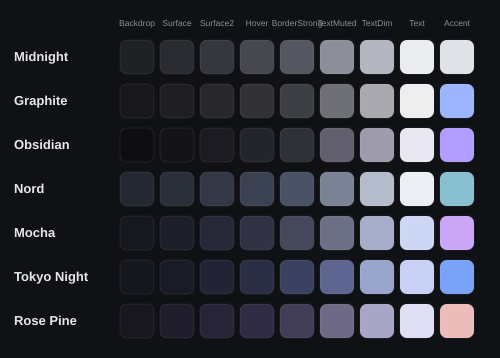

# Design guide

Nocturne aims for a compact, dark, slightly glossy desktop-app feel. Depth comes from layered shadows and top-lit gradients, not from bright color.

## Surfaces

| Layer | Token | Treatment |
| --- | --- | --- |
| Dock, window, popups | `Backdrop` / `Elevated` | CanvasGroup body, 12–15 px radius, 5–7 stacked shadow layers (≈7% opacity each, 3–4 px spread, 4–8 px drop), 1 px glass edge (`BorderStrong`, brighter at the top), 1 px sheen inside the top edge |
| Section panel | `Surface` | 8 px radius, 1 px `Border` stroke, 7% top-lit gradient |
| Fields, idle controls | `Surface2` | 6 px radius (4 px for checks), 1 px stroke |
| Hover / active pills | `Hover` | Same shape as the control, plus a gloss gradient |

The glass edge is a UIStroke on a frame inset 1 px inside the CanvasGroup, so the CanvasGroup's rounded clipping doesn't cut it off.

## Type

The font is Builder Sans throughout.

| Use | Size | Weight | Token |
| --- | --- | --- | --- |
| Window title | 14 | Bold | `Text` |
| Section title / active section tab | 12 | Bold | `Text` |
| Control labels | 12 | Medium | `TextDim` (`Text` when on or hovered) |
| Values | 12 | SemiBold | `Text` |
| Secondary, footer, hints | 11 | Medium | `TextMuted` |
| Badges, divider labels | 10 | Bold | `Text` / `TextMuted` |

## Spacing

- Window 680 × 520: header 44, tab row 36, footer 28.
- Page padding 12, column gap 10, section gap 10.
- Section header 34, body padding 6 / 12 / 10 / 12, row gap 2.
- Row heights: toggle and keybind 26, slider 40, dropdown or input with label 50, button 28, info 24.
- Dock buttons 34 with a 4 gap and 6 padding. Icons are 18 px in the dock and 13–14 px everywhere else.

## Motion

| Preset | Duration | Easing | Used for |
| --- | --- | --- | --- |
| Micro | 80 ms | Quad Out | press-down, slider fill while dragging |
| Fast | 140 ms | Quad Out | hover, color changes, popup close |
| Normal | 220 ms | Quint Out | popups opening, window close |
| Smooth | 320 ms | Quint Out | window open, page switch, dock indicator, theme repaint |
| Slow | 450 ms | Quint Out | dock entrance |

- A new tween on a property replaces the running one (TweenService behaviour), so rapid clicks never stack.
- Window open/close and popup hide are guarded with version counters, so a late "hide" can't hide something that was reopened.
- Reduced motion applies values instantly. Animation speed divides every duration.

## Icons

Icons are drawn on an 18 × 18 grid with a 1.5 stroke (it scales with size): lines with round caps, rings, rounded rects, dots, and clip groups for partial shapes. `tools/export_assets.py` exports each one to `assets/icons/*.svg`, so you can preview or reuse them.

## Accent use

Accent marks state only: a checked toggle fill, the slider fill, the dock dot, the focused field ring, the selected dropdown check, the keybind listening ring and the notification bar. Large areas stay neutral. The default Midnight accent is a soft silver, so the UI reads as monochrome until you pick a color.
