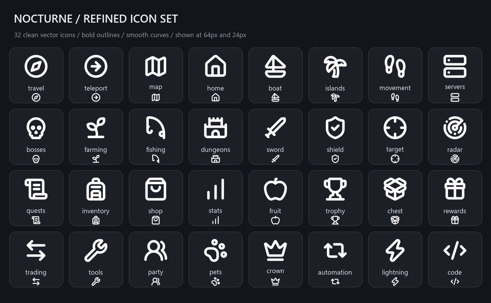

# Nocturne expansion icons

32 clean vector icons adapted from [Lucide](https://lucide.dev/). The original paths use a consistent 2.4px stroke on a 24×24 grid. Each preview tile shows the icon at 64px and 24px.

Use names such as `Icon = "travel"`, `Icon = "bosses"` or `Icon = "fishing"` on categories and buttons. Open the Icons category in `Example.lua` to browse the complete set.

- `svg/`: scalable vector artwork.
- `png/`: transparent 256×256 images.
- `atlas.png`: transparent 2048×1024 sheet, eight columns and four rows, 256×256 cells.
- `atlas.json`: source names and zero-based pixel positions.
- `LICENSE.txt`: Lucide and Feather ISC/MIT notices.

The library downloads and caches the atlas once using the environment's `getcustomasset`/`getsynasset` and file functions. It displays matching native vector fallbacks when these functions or the image download are unavailable. The fallback is removed before the image is shown. Existing Roblox image assets are unchanged.

These expansion PNGs have been published to GitHub; they are not Roblox-uploaded asset IDs. If you upload the atlas to Roblox later, use its image ID with the coordinates in `atlas.json`.

Source commit: `7b0196e249ca09ca27c584c497aca9a8cab8a7f5`. The source SVGs were checked to contain only visual geometry and no external references or event handlers.
